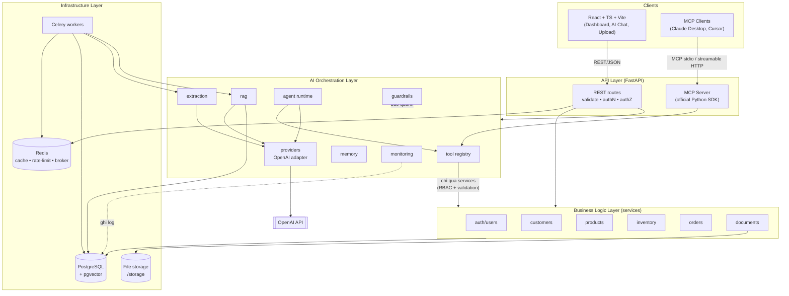
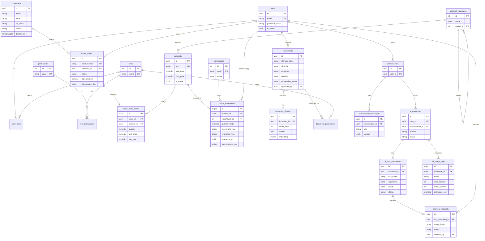

# AI Business Management Platform — Phase 1: Kiến trúc & kế hoạch

> Trạng thái: **Phase 1 – Planning (chưa có code)**. Tài liệu này là nguồn tham chiếu kiến trúc duy nhất; khi đổi kiến trúc phải cập nhật ở đây.

---

## 0. Môi trường hiện tại (đã kiểm tra)

| Công cụ | Trạng thái |
|---|---|
| Python 3.12.10 | OK |
| Git 2.56 | OK |
| Docker / Docker Compose | **Chưa cài** – cần Docker Desktop (WSL2) để chạy PostgreSQL+pgvector, Redis |
| Node.js / npm | **Chưa cài** – cần Node 20 LTS+ cho frontend (từ Phase 2) |
| PostgreSQL local | Không cần – dùng container |

Hệ quả: Phase 1 backend chạy được ngay trên Python; để chạy DB cần cài Docker Desktop trước Milestone M2.

---

## 1. Kiến trúc hệ thống

### 1.1 Quyết định chính

| Quyết định | Lý do | Đánh đổi |
|---|---|---|
| **Modular monolith** | Một deploy, một DB, transaction xuyên module đơn giản (order + stock). Ranh giới module rõ để sau này tách nếu cần. | Phải tự giữ kỷ luật: module không import chéo model của nhau, chỉ gọi qua service. |
| **FastAPI + SQLAlchemy 2.x async (asyncpg)** | I/O-bound (DB, gọi OpenAI) hưởng lợi từ async. | Celery worker là sync → worker dùng engine/session sync riêng (cùng model). |
| **Service layer là cổng duy nhất vào nghiệp vụ** | REST, AI Agent, MCP đều gọi cùng service → cùng validation, RBAC, transaction. Đây là cách thực thi các luật "AI không bypass validation". | Thêm một lớp, nhưng bắt buộc. |
| **Repository mỏng** | Tách query SQL khỏi logic. Không tạo generic repository trừu tượng quá mức (KISS). | Một ít boilerplate. |
| **Tồn kho = sổ cái `stock_movements`** | Không có cột `quantity` sửa tay. Tồn = `SUM(quantity_delta)`. Có lịch sử, audit được. | Đọc tồn tốn SUM → có index (product, warehouse); khi lớn thêm bảng cache `stock_balances` (không làm trước). |
| **Chống race tồn kho bằng `pg_advisory_xact_lock(product, warehouse)`** | "Đọc tồn rồi ghi xuất" là check-then-act; hai request song song có thể làm âm kho. Advisory lock theo (product, warehouse) tuần tự hóa chỉ những request cùng mặt hàng. | Phụ thuộc PostgreSQL (đã chọn sẵn). |
| **Tiền = `NUMERIC(14,2)` / `Decimal`** | Không bao giờ dùng float cho tiền. | — |
| **JWT access token ngắn hạn + denylist `jti` trong Redis** | Logout thực sự vô hiệu hóa token. | Thêm 1 lookup Redis mỗi request; nếu Redis chết thì fail-closed cho logout-check (cấu hình được). |
| **Lõi nghiệp vụ không import gì từ `ai/`** | AI chỉ phụ thuộc vào nghiệp vụ, không ngược lại → app vẫn chạy khi AI/OpenAI chết. | — |

### 1.2 Sơ đồ kiến trúc



**Hướng phụ thuộc (không được đảo):** `api → services → repositories → DB`; `ai/* → services`; `mcp → ai/tools → services`. `services` **không** import `ai`.

### 1.3 Vai trò từng tầng

1. **Presentation (React):** chỉ hiển thị và gọi REST. Không tin tưởng client: mọi con số tiền/số lượng do backend tính lại.
2. **API (FastAPI):** parse + validate request (Pydantic v2), xác thực JWT, kiểm quyền qua dependency, map exception → HTTP response thống nhất. Không chứa logic nghiệp vụ.
3. **Business Logic (modules/*):** mỗi module có `models.py, schemas.py, repository.py, service.py`. Service quản lý transaction (một `AsyncSession` mỗi request, commit ở biên service/UoW), validate nghiệp vụ, kiểm quyền cấp hành động.
4. **AI Orchestration (ai/*):** `providers` bọc OpenAI SDK sau interface nhỏ (để mock trong test và đổi nhà cung cấp); `guardrails` (rate/token limit, prompt-injection, kiểm quyền tool); `monitoring` ghi `ai_executions / ai_tool_executions / ai_usage_logs`; `tools` là registry **tĩnh** (whitelist) – model không tạo được tool mới.
5. **Infrastructure:** PostgreSQL (dữ liệu + vector), Redis (broker Celery, denylist JWT, rate limit), Celery (xử lý tài liệu nặng/bất đồng bộ), file storage (volume `/storage`, tên file là UUID, không dùng tên người dùng đưa vào đường dẫn).
6. **External:** OpenAI, MCP client, email. Mọi lệnh gọi ngoài có timeout + retry có giới hạn + circuit-breaker đơn giản; lỗi → trả lỗi có kiểm soát, không làm sập lõi.

### 1.4 Quy tắc bất biến (từ yêu cầu, dùng làm checklist review)

- AI không chạy SQL tùy ý, không chạm DB trực tiếp.
- Mọi thao tác AI đi qua service → cùng RBAC/validation với REST.
- Hành động nhạy cảm cần `approval_requests`; phê duyệt gắn với **hash của (tool, params)** chính xác.
- Idempotency key cho thao tác tạo đơn / nhập-xuất kho / thực thi sau phê duyệt.
- Nội dung tài liệu là dữ liệu không tin cậy, không bao giờ là chỉ thị.

---

## 2. ERD

Ghi chú: Phase 1–2 tạo các bảng lõi; bảng AI được tạo ở migration của phase tương ứng (để không tạo sớm những thứ chưa dùng). ERD dưới đây là thiết kế đích.



---

## 3. Schema ban đầu

Quy ước chung: PK `UUID` (v4, sinh ở app) cho thực thể nghiệp vụ; `INT` cho bảng tham chiếu nhỏ (roles, permissions, warehouses, categories); `stock_movements` dùng `BIGINT` identity vì là bảng phình to và chỉ-ghi-thêm. Mọi bảng có `created_at timestamptz DEFAULT now()`; bảng có thể sửa có thêm `updated_at`. Soft delete (`deleted_at`) cho `customers`, `products`, `documents`. Đặt tên constraint bằng `naming_convention` của SQLAlchemy để Alembic autogenerate ổn định.

### 3.1 Phase 1 – Auth & RBAC

| Bảng | Cột chính | Ràng buộc / Index |
|---|---|---|
| `users` | id, email, password_hash, full_name, is_active, last_login_at | `UNIQUE(lower(email))` (index trên biểu thức), CHECK email không rỗng |
| `roles` | id, name, description | `UNIQUE(name)`; seed: admin, manager, sales, warehouse, employee |
| `permissions` | id, code (vd `customer:read`), description | `UNIQUE(code)` |
| `user_roles` | user_id, role_id | PK `(user_id, role_id)`, FK ON DELETE CASCADE; index `(role_id)` |
| `role_permissions` | role_id, permission_id | PK `(role_id, permission_id)` |

Quyết định: permission dạng `resource:action` (`customer:read`, `order:confirm`, `document:upload`...). RBAC kiểm tra permission, không kiểm tra tên role trong code nghiệp vụ → thêm role không phải sửa code. Mật khẩu: Argon2id (hoặc bcrypt) qua thư viện đã được kiểm chứng, không tự viết.

### 3.2 Phase 2 – Nghiệp vụ lõi

| Bảng | Cột chính | Ràng buộc / Index |
|---|---|---|
| `customers` | name, email, phone, company_name, tax_code, address, customer_type, status, deleted_at | partial `UNIQUE(tax_code) WHERE tax_code IS NOT NULL AND deleted_at IS NULL`; index `(status)`; trigram/`lower(name)` cho tìm kiếm; CHECK status ∈ {active,inactive} |
| `product_categories` | name, parent_id | `UNIQUE(parent_id, name)`; FK self |
| `products` | name, sku, description, category_id, sale_price, cost_price, unit, is_active, deleted_at | partial `UNIQUE(sku) WHERE deleted_at IS NULL`; CHECK `sale_price >= 0`, `cost_price >= 0`; index `(category_id)` |
| `warehouses` | code, name, address, is_active | `UNIQUE(code)` |
| `stock_movements` | product_id, warehouse_id, quantity_delta, movement_type (in/out/adjust/reserve…), reference_type, reference_id, note, created_by, idempotency_key | CHECK `quantity_delta <> 0`; index `(product_id, warehouse_id)` (tính tồn); partial `UNIQUE(idempotency_key) WHERE idempotency_key IS NOT NULL`; **bảng append-only** (không UPDATE/DELETE; sai thì ghi bút toán điều chỉnh) |
| `sales_orders` | order_number, customer_id, status, subtotal, tax_amount, total_amount, notes, created_by, idempotency_key, confirmed_at | `UNIQUE(order_number)`; CHECK status ∈ {draft,pending,confirmed,processing,completed,cancelled}; CHECK total = subtotal + tax; index `(customer_id, created_at DESC)`, `(status)`; `UNIQUE(created_by, idempotency_key)` |
| `sales_order_items` | order_id, product_id, quantity, unit_price, tax_rate, line_total | CHECK `quantity > 0`; `UNIQUE(order_id, product_id)`; index `(order_id)`. `unit_price` là **snapshot** giá lúc đặt, backend ghi, client không gửi |

Máy trạng thái đơn hàng (backend ép): `draft → pending → confirmed → processing → completed`; `draft/pending/confirmed → cancelled`. Chỉ `draft` mới sửa được. Xác nhận đơn = một transaction: khóa advisory các (product, warehouse) liên quan → kiểm tồn → ghi `stock_movements` → đổi status.

### 3.3 Phase 2–4 – Tài liệu & AI (tạo ở migration phase tương ứng)

| Bảng | Ghi chú |
|---|---|
| `documents` | storage_path (UUID), original_filename, mime_type, size_bytes, `sha256` (phát hiện trùng), category, `visibility` (private/role/company), processing_status (uploaded/processing/ready/failed), uploaded_by, deleted_at. `UNIQUE(sha256) WHERE deleted_at IS NULL` hoặc theo ngữ cảnh – quyết ở Phase 4 |
| `document_permissions` *(bảng bổ sung so với danh sách đề bài)* | document_id, role_id/user_id. Cần để "document permissions" thực thi được ở mức role/user; không nhét vào mảng JSON để còn index và join lọc được |
| `document_chunks` | document_id, chunk_index, content, `embedding vector(1536)`, token_count, metadata jsonb. Index HNSW `vector_cosine_ops`; `UNIQUE(document_id, chunk_index)`. **Lọc quyền ở SQL trước khi lấy top-k**, không lọc sau |
| `document_extractions` *(bổ sung, Phase 3)* | Lưu kết quả trích xuất chờ duyệt (jsonb + trạng thái draft/confirmed/rejected) – cần cho luồng "người dùng xem → sửa → xác nhận" |
| `conversations`, `conversation_messages` | role ∈ {user, assistant, tool}; content jsonb; index `(conversation_id, created_at)` |
| `ai_executions` | request_id, user_id, conversation_id, feature (extraction/rag/agent/mcp), provider, model, status, duration_ms, error |
| `ai_tool_executions` | execution_id, tool_name, arguments jsonb, result jsonb, status, error, started/finished; không lưu nội dung nhạy cảm không cần thiết |
| `ai_usage_logs` | execution_id, model, input_tokens, output_tokens, estimated_cost `NUMERIC(12,6)`; index `(user_id, created_at)` cho hạn mức |
| `approval_requests` | tool_execution_id, `action_hash` (SHA-256 của tool + params chuẩn hóa), status (pending/approved/rejected/expired/executed), requested_by, decided_by, expires_at. Thực thi chỉ khi hash khớp đúng → approval gắn với hành động chính xác |

Kích thước embedding 1536 phù hợp `text-embedding-3-small`; sẽ **xác minh model/dimension theo tài liệu OpenAI hiện hành** ở Phase 4 trước khi tạo migration.

---

## 4. Cấu trúc thư mục

Giữ gần đúng cấu trúc đề bài, điều chỉnh có lý do:

```
AI/                                  (gốc repo; đề bài gọi là ai-business-platform/)
├── backend/
│   ├── app/
│   │   ├── main.py                  # tạo FastAPI app, gắn router, exception handler
│   │   ├── config.py                # pydantic-settings, đọc env
│   │   ├── core/
│   │   │   ├── database.py          # async engine, session factory, Base, naming convention
│   │   │   ├── security.py          # hash mật khẩu, tạo/verify JWT
│   │   │   ├── permissions.py       # định nghĩa permission codes + check
│   │   │   ├── exceptions.py        # AppError và các lỗi miền (NotFound, Conflict, Forbidden...)
│   │   │   └── logging.py           # structured logging (JSON), request_id
│   │   ├── modules/
│   │   │   ├── auth/  users/  customers/  products/  inventory/  orders/  documents/
│   │   │   │   └── models.py schemas.py repository.py service.py
│   │   ├── ai/
│   │   │   └── providers/ extraction/ rag/ agents/ tools/ memory/ guardrails/ monitoring/
│   │   ├── mcp/                     # server.py, tools.py (gọi lại ai/tools → services)
│   │   ├── workers/                 # [THÊM] celery_app.py, tasks  (xem giải thích)
│   │   └── api/
│   │       ├── dependencies.py      # get_session, get_current_user, require_permission
│   │       └── routes/              # mỗi module một router, prefix /api/v1
│   ├── tests/                       # unit/ và integration/
│   ├── alembic/  alembic.ini
│   ├── requirements.txt             # (+ requirements-dev.txt)
│   └── Dockerfile
├── frontend/  (src/ public/ package.json Dockerfile)   # Vite + React + TS + Tailwind
├── infrastructure/
│   ├── docker-compose.yml
│   └── redis/
├── storage/                         # git-ignored, mount làm volume
├── docs/
├── .env.example  .gitignore  README.md
```

Thay đổi so với đề bài (đều có lý do):
- **Thêm `backend/app/workers/`:** Celery cần entrypoint riêng (`celery -A app.workers.celery_app`) và task không nên nằm lẫn trong module nghiệp vụ. Thêm ở Phase 3 khi cần, chưa tạo trước.
- **`ai/` và `mcp/` tạo thư mục rỗng có `.gitkeep`** để thể hiện ranh giới, nhưng chưa có code đến phase của chúng.
- Mỗi module business dùng 4 file phẳng (`models/schemas/repository/service`), tách thành package chỉ khi file vượt ~300 dòng.
- Frontend theo feature: `src/features/{auth,customers,products,orders,...}`, `src/api/`, `src/components/`.

---

## 5. Thiết lập môi trường phát triển

**Windows (máy này):**
1. Cài **Docker Desktop** (bật WSL2) – bắt buộc cho Postgres/pgvector/Redis.
2. Cài **Node.js 20 LTS** (cần từ Phase 2).
3. Python 3.12 + Git đã có.
4. Tạo virtualenv trong `backend/`:
   ```powershell
   cd D:\Odoo\AI\backend
   py -3.12 -m venv .venv
   .\.venv\Scripts\Activate.ps1
   python -m pip install --upgrade pip
   ```
5. Sao chép `.env.example` → `.env` và điền giá trị (`SECRET_KEY` sinh ngẫu nhiên, `OPENAI_API_KEY` chỉ cần từ Phase 3). **Không commit `.env`.**
6. IDE: VS Code hoặc PyCharm; Postman/Swagger UI (`/docs`) để thử API.

**Production:** Linux + Docker Compose; biến môi trường/secret qua file `.env` không đưa vào image.

Phiên bản thư viện: sẽ chốt ở `requirements.txt` bằng bản ổn định mới nhất **sau khi** `pip index versions`/`pip install` xác nhận, không đoán từ trí nhớ.

---

## 6. Thiết kế Docker Compose

Dịch vụ và vai trò:

| Service | Image / build | Ghi chú |
|---|---|---|
| `db` | `pgvector/pgvector:pg16` (xác minh tag khi triển khai) | volume `pgdata`; healthcheck `pg_isready`; script init `CREATE EXTENSION IF NOT EXISTS vector` (cũng đặt trong migration để không phụ thuộc init script) |
| `redis` | `redis:7-alpine` | volume `redisdata`; healthcheck `redis-cli ping`; không public port ở prod |
| `backend` | build `backend/` | `depends_on: db, redis (healthy)`; chạy `alembic upgrade head` rồi `uvicorn`; mount `storage` |
| `worker` | cùng image backend | `celery -A app.workers.celery_app worker` – bật từ Phase 3 |
| `frontend` | build `frontend/` | Vite dev ở dev, nginx static ở prod – bật từ Phase 2 |

Phác thảo (Phase 1 chỉ cần `db`, `redis`, `backend`):

```yaml
services:
  db:
    image: pgvector/pgvector:pg16
    environment:
      POSTGRES_USER: ${POSTGRES_USER}
      POSTGRES_PASSWORD: ${POSTGRES_PASSWORD}
      POSTGRES_DB: ${POSTGRES_DB}
    volumes: [pgdata:/var/lib/postgresql/data]
    ports: ["127.0.0.1:5432:5432"]      # chỉ localhost
    healthcheck:
      test: ["CMD-SHELL", "pg_isready -U $${POSTGRES_USER} -d $${POSTGRES_DB}"]
      interval: 5s
      retries: 10
  redis:
    image: redis:7-alpine
    volumes: [redisdata:/data]
    healthcheck: { test: ["CMD", "redis-cli", "ping"], interval: 5s, retries: 10 }
  backend:
    build: ../backend
    env_file: ../.env
    depends_on:
      db: { condition: service_healthy }
      redis: { condition: service_healthy }
    volumes: ["../storage:/app/storage"]
    ports: ["8000:8000"]
volumes: { pgdata: {}, redisdata: {} }
```

Trong dev, có thể chạy backend trên host (uvicorn `--reload`) và chỉ `docker compose up db redis` cho nhanh.

---

## 7. Cột mốc phát triển Phase 1

| # | Milestone | Kết quả kiểm chứng được |
|---|---|---|
| M0 | Khởi tạo repo: cấu trúc thư mục, `.gitignore`, `.env.example`, git init | Cây thư mục đúng, `git status` sạch |
| M1 | FastAPI skeleton + config + logging + exception handler + `/health` | `uvicorn` chạy; `GET /health` 200; test pytest đầu tiên pass |
| M2 | Docker Compose (db, redis) + SQLAlchemy async + Alembic | `docker compose up` ok; `alembic upgrade head` ok; health kiểm tra DB |
| M3 | Models auth/RBAC + migration + seed roles/permissions | Bảng tạo đúng, seed idempotent |
| M4 | Register/Login/Logout + JWT + hash mật khẩu | Test: đăng ký, login, token sai/hết hạn, logout vô hiệu token |
| M5 | RBAC dependency `require_permission` + quản lý role | Test: 401 vs 403 đúng; admin gán role |
| M6 | Tests tích hợp (DB thật), CI cơ bản, README phần cài đặt | `pytest` xanh; chạy từ đầu theo README được |

**Acceptance Phase 1:** backend chạy trong Docker Compose, kết nối DB, auth + RBAC hoạt động, lỗi trả về dạng thống nhất, log có `request_id`, test pass.

---

## 8. Task triển khai đầu tiên: M0 + M1

Phạm vi nhỏ, không cần Docker:
1. Tạo cấu trúc thư mục + `.gitignore`, `.env.example`, `README.md` khung, `git init`.
2. Tạo venv, `requirements.txt` (FastAPI, uvicorn, pydantic-settings, SQLAlchemy, asyncpg, alembic, pytest, httpx…) với phiên bản đã xác minh.
3. `config.py` (pydantic-settings), `core/logging.py`, `core/exceptions.py`, `main.py` với `/health`, test đầu tiên.

Khái niệm cần nắm trước: *Settings & 12-factor config*, *Dependency Injection trong FastAPI*, *Exception → HTTP mapping*, *Structured logging & request id*.

---

## 9. Danh sách kiểm tra

- [x] Kiểm tra môi trường máy
- [x] Kiến trúc + sơ đồ + ERD + schema + cấu trúc thư mục + Docker Compose + milestone (tài liệu này)
- [x] Duyệt kiến trúc (bạn)
- [x] Cài Docker Desktop (Node.js: chưa cần, cài trước Phase 2)
- [x] M0 – M6 hoàn thành

### Khác biệt so với thiết kế ban đầu (thực tế triển khai)

- Thêm `GET /health/ready` (kiểm tra DB + Redis) bên cạnh `/health` (liveness).
- Chạy app bằng `uvicorn app.main:create_app --factory` (không còn biến `app` toàn cục).
- Redis DB 0 cho ứng dụng; test dùng Redis DB 15 và database `<db>_test` riêng.
- Docker Compose: PostgreSQL host port **5433** (máy dev đã có PostgreSQL ở 5432).
- Thêm `app/models.py` gom toàn bộ model cho Alembic; `app/modules/users/create_admin.py` để tạo admin đầu tiên.
- `user_roles.role_id` là `ON DELETE RESTRICT`; admin không thể bị gỡ nếu là admin hoạt động cuối cùng (khóa `FOR UPDATE` trên role admin).
- Chưa làm (chuyển sang phase sau): rate limiting đăng nhập, refresh token, worker Celery, frontend.
